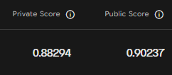

# RSNA Intracranial Aneurysm Detection

My solution for the [RSNA Intracranial Aneurysm Detection](https://www.kaggle.com/competitions/rsna-intracranial-aneurysm-detection) competition on Kaggle: a 3D U-Net that finds aneurysms in CTA, MRA and MRI series and assigns them to one of 13 arterial locations.

This is a late submission, made after the competition ended. It scores 0.88294 on the private leaderboard and 0.90237 on the public leaderboard. The 5-fold cross-validation score is 0.8997.

| | score |
|---|---|
| 5-fold CV (out of fold, 4348 series) | 0.8997 |
| Public leaderboard | 0.90237 |
| Private leaderboard | 0.88294 |



## Method

**Preprocessing.** A series is a stack of 2D DICOM images. Each series is turned into one 3D image: a cube of 256 x 256 x 256 voxels centered on the brain. This way every scan has the same format and orientation, whatever the scanner or the modality.

- The slices are put back in the right order using the position information stored in the DICOM files, and only the information that is also present in the test scans is used. Some scans are fixed on the way, for example CT scans with a wrong brightness offset, or files where the pixel size is missing.
- HD-BET, a tool made to find the brain in a scan, gives the brain area, and the cube is cut around it.
- CT and MRI brightness values are put on the same 0 to 255 scale. Everything more than 2 cm away from the brain (neck, face, background) is set to black. The 2 cm margin keeps the arteries at the base of the brain, where aneurysms are.
- 178 training series come with masks of the brain arteries. These masks are moved into the same cube, so the model can learn where each artery is.

**Model.** The model is a 3D U-Net. It looks at a block of 128 x 128 x 128 voxels and gives two answers for every point of the block:

- how likely it is that an aneurysm is there (a heatmap). During training, the target is a small blob around each aneurysm point marked in the training data;
- which of the 13 artery locations the point belongs to, or none.

The first half of the network (the encoder) comes from [nnFoundationCNN](https://huggingface.co/MIC-DKFZ/nnFoundationCNN), which was already trained on a very large number of unlabeled 3D scans, so it starts with a good idea of what medical images look like. The second half (the decoder) is new and is trained here. Its CBAM attention blocks help it focus on the useful parts of the image. The model also receives the position of each point in the cube, because aneurysms appear in typical places. Two small extra outputs are used only to help the training.

The final answer for a series comes from its strongest points. The probability that there is an aneurysm is the average of the 8 highest heatmap values, and the probability of each location is computed the same way, from the heatmap combined with the artery map.

**Training.** The data is split into 5 parts. Each of the 5 models is trained on 4 parts and checked on the remaining one, and all the series of a patient stay in the same part. Half of the training blocks contain an aneurysm, and rare locations and modalities are shown more often so that the model does not ignore them. The blocks are also randomly flipped left to right (with the left and right labels swapped), rotated, resized, changed in brightness and contrast, and made blurrier or noisier, so the model sees more variety than the data alone gives. Each model trains for 36,000 steps, about 10 hours on two T4 GPUs.

**Inference.** A new series goes through the same preprocessing. The model is moved block by block over the part of the cube where aneurysms appear in the training data, and the answers of the 5 models are averaged.

## Setup

```
pip install -r requirements.txt
```

Download the competition data into `data/rsna-intracranial-aneurysm-detection` (or change `DATA_DIR` at the top of `preprocess.py`).

## 1. Preprocessing

```
python preprocess.py
```

It runs one process per GPU. If it stops, run it again: finished series are skipped. The output goes to `data/prepared` (about 24 GB):

- `vol/` one file per series with the cube, the distance map and the territory labels
- `series.parquet` labels, folds and preprocessing details for each series
- `points.parquet` aneurysm positions in cube coordinates
- `prep_config.json` and `ps_table.json`, needed again at inference

## 2. Training

Train the folds one by one. Set the fold at the top of `train.py`:

```python
FOLD = 0
```

and run

```
torchrun --standalone --nproc_per_node=2 train.py
```

Repeat with `FOLD = 1`, `2`, `3` and `4`. On Kaggle 2x T4 put `NCCL_P2P_DISABLE=1` in front of the command.

The pretrained weights are downloaded from Hugging Face on the first run. The training state is saved every 1000 steps in `runs/fold0/train_state.pth` and the same command resumes from it. At the end `runs/fold0/model.pt` is written and the held-out fold is evaluated (`val.json`, `oof.parquet`).

## 3. Kaggle submission

```
python export.py
```

This puts the 5 models, the HD-BET weights, the preprocessing files, the code and the wheels of the packages missing on Kaggle into `kaggle_dataset/`. Some of the wheels are compiled, so run it with the same Python version as the Kaggle image (a Kaggle notebook with internet on works). Upload the folder as a Kaggle dataset, then create a notebook with GPU T4 x2, internet off, the competition data and the dataset attached, and run:

```
!pip install -q --no-index --no-deps /kaggle/input/aneurysm-models/wheels/*.whl
%run /kaggle/input/aneurysm-models/submit.py
```

(use the path where Kaggle mounts your dataset). The hidden test set takes about 8 to 9 hours. Series that are still left after 10.5 hours, or that fail, get the training prevalence.


